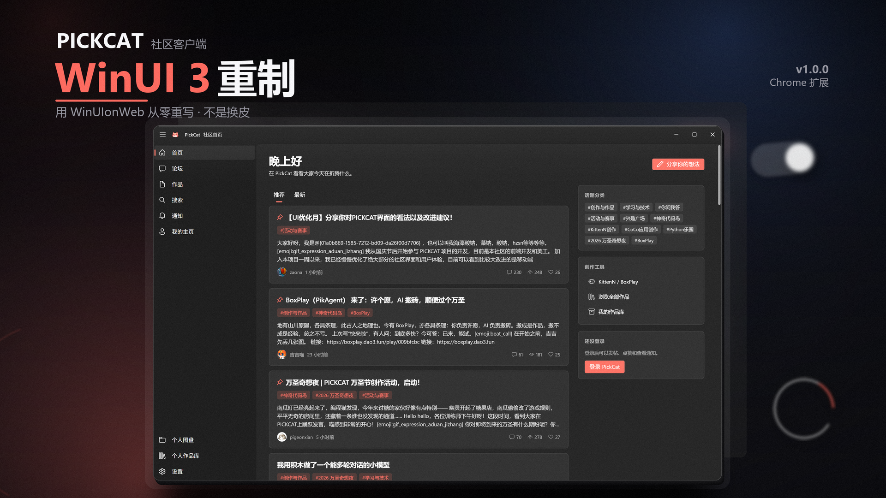

<div align="center">

# PickCat WinUI 3 Edition

面向 PickCat 社区的替代前端实现，以 Chrome 扩展与 Windows 桌面应用两种形式发布。

[](https://github.com/ttummc/pickcat-winui3/releases)
[](https://github.com/ttummc/pickcat-winui3/actions/workflows/build.yml)
[](LICENSE)

</div>

## 项目说明

本项目重新实现 PickCat（`pickcat.dao3.fun`）的前端界面，不沿用原站的页面结构与样式表。
界面由独立实现的组件构成，包括窗口标题栏、导航栏、上下文菜单、Markdown 编辑器、
消息提示与对话框；交互逻辑按桌面应用的规范设计，与网页默认行为存在差异。

项目以浏览器扩展和 Windows 桌面应用两种形式分发。桌面应用基于 WinUI 3 与 WebView2，
在独立窗口中运行同一套界面代码。

## 下载

### 第三方存储镜像

以下地址由项目维护者同步维护，内容与 GitHub Release 资产一致：

| 存储服务 | 地址 |
| --- | --- |
| OneDrive | [![OneDrive](https://img.shields.io/badge/OneDrive-0078D4?style=for-the-badge&logo=data%3Aimage%2Fsvg%2Bxml%3Bbase64%2CPHN2ZyB4bWxucz0iaHR0cDovL3d3dy53My5vcmcvMjAwMC9zdmciIHdpZHRoPSIxLjU2ZW0iIGhlaWdodD0iMWVtIiB2aWV3Qm94PSIwIDAgMjU2IDE2NSI%2BPHBhdGggZmlsbD0iIzAzNjRiOCIgZD0ibTE1NC42NiAxMTAuNjgybDUyLjg0Mi01MC41MzRjLTEwLjk3Ni00Mi44LTU0LjU3LTY4LjU5Ny05Ny4zNy01Ny42MmE4MCA4MCAwIDAgMC00Ni45NTIgMzMuNTFjLjgxNy0uMDIgOTEuNDggNzQuNjQ0IDkxLjQ4IDc0LjY0NCIvPjxwYXRoIGZpbGw9IiMwMDc4ZDQiIGQ9Im05Ny42MTggNDUuNTUybC0uMDAyLjAwOWE2My43IDYzLjcgMCAwIDAtMzMuNjE5LTkuNTQzYy0uMjc0IDAtLjU0NC4wMTctLjgxOC4wMkMyNy44NTIgMzYuNDc2LS40MzIgNjUuNDcuMDA1IDEwMC43OThhNjMuOTcgNjMuOTcgMCAwIDAgMTEuNDkzIDM1Ljc5OGw3OS4xNjUtOS45MTVsNjAuNjk0LTQ4Ljk0eiIvPjxwYXRoIGZpbGw9IiMxNDkwZGYiIGQ9Ik0yMDcuNTAyIDYwLjE0OGE1MyA1MyAwIDAgMC0zLjUxLS4xMzFhNTEuOCA1MS44IDAgMCAwLTIwLjYxIDQuMjU0bC0uMDAyLS4wMDVsLTMyLjAyMiAxMy40NzVsMzUuMzAyIDQzLjYwN2w2My4xMSAxNS4zNDFjMTMuNjItMjUuMjgzIDQuMTY0LTU2LjgyLTIxLjEyLTcwLjQ0YTUyIDUyIDAgMCAwLTIxLjE0OC02LjEiLz48cGF0aCBmaWxsPSIjMjhhOGVhIiBkPSJNMTEuNDk4IDEzNi41OTZhNjMuOTEgNjMuOTEgMCAwIDAgNTIuNSAyNy40MTdoMTM5Ljk5NGE1MS45OSA1MS45OSAwIDAgMCA0NS43NzgtMjcuMzIzbC05OC40MTMtNTguOTV6Ii8%2BPC9zdmc%2B&logoColor=white)](https://1drv.ms/f/c/b2c0d7744e9876a7/IgC9Q1_GvXwIQp5IBeGCS_BuAXY-1ZHx1t6pYLS1RNN1ZUc?e=EtPhdu) |
| Google Drive | [](https://drive.google.com/drive/folders/1j9yLswHUpb92_MnlfrdbN2fuZFybJrnx?usp=sharing) |
| Dropbox | [](https://www.dropbox.com/scl/fo/y9qakmyil0rafk2bmup9m/AFHY-os6APdT555OFZ3UNW8?rlkey=grg3e4v2rteys0j729sy43bry&st=cmwm5bp5&dl=0) |
| Proton Drive | [](https://drive.proton.me/urls/EY88C0MZ7G#96gfYMtKmdnk) |
| pCloud | [](https://u.pcloud.link/publink/show?code=kZigGjJZpkS0XqHtLIXUanaC5dOzm81zMLq7) |
| MEGA | [](https://mega.nz/folder/tZVQWL5I#5f9r7yX_TFi5jr3VV7x5mQ) |

### GitHub Release

| 分发形式 | 获取方式 |
| --- | --- |
| 浏览器扩展（Chrome / Edge） | [PickCat-WinUI3-extension.zip](https://github.com/ttummc/pickcat-winui3/releases/latest/download/PickCat-WinUI3-extension.zip) |
| Windows 桌面应用 | [Releases](https://github.com/ttummc/pickcat-winui3/releases/latest) 页面中的 `PickCatWinUI3-Setup-*.msi` |
| 历史版本 | 本仓库 [`releases/`](releases) 目录，或 [Release 列表](https://github.com/ttummc/pickcat-winui3/releases) |

Release 页面提供 `SHA256SUMS.txt`，可用于校验下载文件的完整性。

<div align="center">



</div>

## 两种分发形式

| 形式 | 说明 | 安装方式 |
| --- | --- | --- |
| 浏览器扩展 | 在 Chrome 或 Edge 中替换 `pickcat.dao3.fun` 的界面 | 解压后通过「加载已解压的扩展程序」安装 |
| Windows 桌面应用 | 独立的 WinUI 3 窗口，不依赖浏览器运行 | 运行 `PickCatWinUI3-Setup-*.msi` |

桌面应用安装包约 68 MB，安装过程不需要管理员权限，安装后写入开始菜单，
可通过「设置 → 应用」卸载。运行环境为 Windows 10 或 Windows 11（x64）。

## 功能说明

**组件实现**

界面中的标题栏、导航栏、上下文菜单、对话框、消息提示与进度指示均以组件形式实现，
包含焦点、悬停与按压状态。

**页面转场**

层级导航采用方向性转场：进入下级页面自右侧滑入，返回时反向退出，同级切换使用淡入。
列表项在加载时按序出现，可交互卡片在按压时缩放。

**上下文菜单**

右键菜单覆盖卡片操作、选中文本复制、选中文本中的 URL 打开、链接地址复制、页面刷新
与返回顶部。空白区域的右键菜单同样由项目实现。

**账户登录**

登录流程使用原站页面，滑块验证在官方页面完成。本项目不读取、不保存账户密码。

**主题**

提供浅色、深色与跟随系统三种模式，并提供四套强调色；标题栏与界面同步切换。

**数据范围**

全部网络请求发往 `pickcat.dao3.fun`。本地仅保存主题模式与强调色两项偏好设置。

## 安装

### 浏览器扩展

1. 下载 `PickCat-WinUI3-extension.zip`，解压至长期保留的目录，例如
   `C:\Users\<用户名>\PickCatWinUI3`
2. 访问 `chrome://extensions`（Edge 为 `edge://extensions`），启用「开发者模式」
3. 点击「加载已解压的扩展程序」，选择步骤 1 创建的目录（目录中应包含 `manifest.json`）
4. 访问 `https://pickcat.dao3.fun/`

安装目录不得为 `C:\Program Files`。该目录受系统保护，Chrome 读取扩展资源时会失败并
报告 `rules.json: Internal error while parsing rules`。同时建议避免使用下载目录或
云同步目录。

### Windows 桌面应用

从 [Releases](https://github.com/ttummc/pickcat-winui3/releases/latest) 下载
`PickCatWinUI3-Setup-*.msi` 并运行。安装包未进行代码签名，Windows SmartScreen 可能
显示安全提示，需选择「更多信息 → 仍要运行」。

## 页面覆盖范围

已重写：首页、论坛、分类、帖子详情、发帖编辑器、作品列表、作品详情（含内嵌播放器）、
个人主页、通知、搜索、个人图盘、个人作品库、设置。

未重写：注册、找回密码、圈子、创作、入站考试、内容审核。上述页面会显示「在原站打开」
按钮，不会以占位界面替代。

## 构建

```bash
npm install

# 浏览器扩展（产物位于 extension/dist，可直接作为扩展加载）
npx vite build

# Windows 桌面应用（需要 .NET 10 SDK）
dotnet publish desktop/PickCat.WinUI3/PickCat.WinUI3.csproj \
  -c Release -r win-x64 --self-contained -o desktop/publish
```

发布流程（版本号递增、构建、同步安装目录、打包、生成安装包、归档、创建标签）：

```powershell
powershell -File tools\release.ps1 -Version 1.2.0
```

## 实现说明

<details>
<summary>使用的 WinUI 控件</summary>

`TitleBar` `NavigationView` `SelectorBar` `Button` `TextBox` `InfoBar`
`ContentDialog` `ProgressBar` `ProgressRing` `InfoBadge` `PersonPicture`
`SettingsCard` `Expander` `ToolTip` `MenuFlyout` `PipsPager` `FontIcon`

</details>

<details>
<summary>目录结构</summary>

```
extension/         浏览器扩展（Vue 3 + WinUIonWeb）
  src/pages/        各页面
  src/components/   共用组件
  public/           manifest 与后台脚本
docs/               GitHub Pages 站点与截图
releases/           各版本的扩展压缩包
desktop/            WinUI 3 桌面应用
installer/          WiX 安装包定义
captures/           开发过程截图与演示素材（不发布）
tools/              构建、验证与录制脚本
```

</details>

<details>
<summary>已知技术约束</summary>

- WebView2 环境不提供 `chrome.runtime`，代码中所有 `chrome.*` 调用均需存在性判断
- `AddScriptToExecuteOnDocumentCreatedAsync` 在所有子框架中执行，子框架需通过
  `window.top !== window.self` 跳过初始化
- 进入全屏的元素不能在 DOM 中移动，否则浏览器会立即退出全屏
- 祖先元素存在 `transform` 时，后代的 `position: fixed` 相对该祖先定位，而非视口
- 文件上传接口要求 `Idempotency-Key` 请求头与 `ownership=PERSONAL` 表单字段
- `/topics` 接口的 `sort` 参数仅接受 `latest` 与 `relevance`，按活跃度排序由客户端计算

</details>

## 相关链接

- 项目站点：<https://ttummc.github.io/pickcat-winui3/>
- 更新日志：[CHANGELOG.md](CHANGELOG.md)
- 历史版本：[releases/](releases)
- 隐私说明：[PRIVACY.md](PRIVACY.md)

## 声明

本项目为非官方实现，与 PickCat 官方无隶属关系，未获其授权或认可。扩展仅在
`pickcat.dao3.fun` 生效，停用后原站界面立即恢复。项目以 GPL-3.0 许可发布；所使用
的界面库 [WinUIonWeb](https://github.com/Furry-Xiyi/WinUIonWeb) 同样采用 GPL-3.0。
