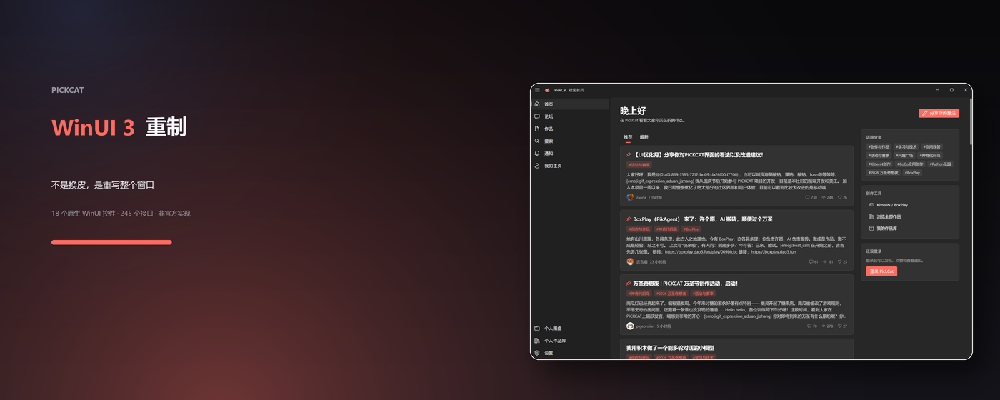

# PickCat · WinUI 3 Edition

[](https://github.com/ttummc/pickcat-winui3/releases/latest/download/PickCat-WinUI3-extension.zip)
[](https://github.com/ttummc/pickcat-winui3/releases/latest)
[](https://ttummc.github.io/pickcat-winui3/)

[](https://github.com/ttummc/pickcat-winui3/actions/workflows/build.yml)
[](LICENSE)

**English** · [简体中文](README.zh-CN.md)

> **Unofficial project.** This is a fan-made client. It is not affiliated with, endorsed by, or
> authorised by PickCat. It only activates on `pickcat.dao3.fun` and collects no user data
> (see [PRIVACY.md](PRIVACY.md)).

## Two ways to run it

| | What it is | How to install |
|---|---|---|
| **Browser extension** | Runs inside Chrome / Edge on `pickcat.dao3.fun` | Load unpacked — steps below |
| **Windows app** | A real desktop window (WinUI 3 + WebView2), no browser involved | Run `PickCatWinUI3-Setup-*.msi` from [Releases](https://github.com/ttummc/pickcat-winui3/releases/latest) |

The installer is ~68 MB, needs no administrator rights, adds a Start-menu entry, and uninstalls
from *Settings → Apps* like any other program. Windows 10/11 x64.

## Install

1. Download **[PickCat-WinUI3-extension.zip](https://github.com/ttummc/pickcat-winui3/releases/latest/download/PickCat-WinUI3-extension.zip)**
2. Extract it into a folder **inside your user profile**, e.g. `C:\Users\<your-name>\PickCatWinUI3`.
   **Not** `C:\Program Files` — it is protected, and Chrome fails there with
   `rules.json: Internal error while parsing rules`. Not `Downloads` either, and not a synced folder
3. Open `chrome://extensions` in Chrome
4. Turn on **Developer mode** (top right)
5. Click **Load unpacked** and select the folder that **directly contains `manifest.json`**

Visit <https://pickcat.dao3.fun/> and the new UI is already there.

> Only active on `pickcat.dao3.fun`. Disable the extension and the original site comes back.

📖 **[Full installation guide](docs/INSTALL.md)** — folder layout, every error message and its fix,
updating, uninstalling.

> Prefer a page with screenshots and step-by-step instructions?
> **<https://kitter.cn/pickcat-winui3/>** walks through it in five steps.

PickCat's community site, **rebuilt from scratch as a Windows 11 style application**. This is not a
reskin: the original UI is dropped entirely and replaced with a new interface written against the
site's own HTTP API.

- UI toolkit: [WinUIonWeb](https://github.com/Furry-Xiyi/WinUIonWeb) (Vue 3 + real WinUI 3 controls)
- Form factor: Chrome extension (MV3) that takes over the window on the original domain
- Data: the site's real API — 245 endpoints documented in [docs/API.md](docs/API.md)

**Install:** grab `PickCat-WinUI3-extension.zip` from [Releases](https://github.com/ttummc/pickcat-winui3/releases), or build from source (below).



---

## What it looks like

The window is made of actual WinUI controls: `TitleBar` (with the three caption buttons),
`NavigationView` (left pane plus footer items), `Button`, `TextBox`, `PasswordBox`, `InfoBar`,
`ProgressRing`, `InfoBadge`, `TeachingTip` and more. Icons come from Segoe Fluent Icons; colours
come from WinUI's Fluent tokens (`--card-bg`, `--text-primary`, `--accent-base`, …).

Light / dark / follow-system themes, four accent colours (PickCat coral by default).

---

## Install (from source)

```powershell
npm install
cd extension
npx vite build          # output goes to extension/dist
```

Then in Chrome:

1. Open `chrome://extensions`
2. Enable **Developer mode** (top right)
3. Click **Load unpacked** and pick the `extension/dist` folder
4. Open <https://pickcat.dao3.fun/> — the new UI is already there

> Only active on `pickcat.dao3.fun`. Disable the extension and the original site comes back.

---

## How it works

```
┌─────────────────────────────── pickcat.dao3.fun ───────────────────────────────┐
│                                                                                │
│  rules.json (declarativeNetRequest)  ── blocks the site's own /_nuxt/ JS/CSS    │
│                                                                                │
│  content.css  ── hides everything on <body> except #pickcat-root                │
│                                                                                │
│  content.js (isolated world) ── Vue 3 + winuionweb, mounted into #pickcat-root  │
│         │                                                                      │
│         └── fetch('/api/v1/...')  ← same origin, cookies just work, no CORS     │
│                                                                                │
│  bridge.js (MAIN world) ── the only code that can reach the page's             │
│                             window.initAliyunCaptcha; talks to content.js       │
│                             over CustomEvents with JSON-string payloads         │
└────────────────────────────────────────────────────────────────────────────────┘
```

Three deliberate decisions:

1. **Block the original bundle instead of covering it.** A static `declarativeNetRequest` rule blocks
   `/_nuxt/`, so the Nuxt app never boots — it cannot fight us for the DOM or fire its own requests.
2. **The UI is genuinely rewritten.** Routing is our own hash router (`#/forum/post/<id>`); every page
   is a new Vue component with layout, hierarchy and interaction redesigned around WinUI conventions.
3. **The CAPTCHA needs a world bridge.** An MV3 content script lives in the isolated world and cannot
   see the page's `window.initAliyunCaptcha`, and MV3 forbids injecting inline scripts. The bridge is
   therefore declared with `content_scripts[].world = "MAIN"`.

---

## Pages

| Route | Page | Main endpoints |
| --- | --- | --- |
| `#/` | Home (recommended / latest feed) | `/topic-recommendations`, `/topics`, `/tags` |
| `#/forum` | Forum overview + categories | `/topics?sort=latest`, `/tags` |
| `#/forum/category/:slug` | Topics in a category | `/topics?tag=<slug>` |
| `#/forum/post/:id` | Topic detail (body, nested replies) | `/topics/{id}`, `/topics/{id}/posts`, `POST /posts`, `PUT /posts/{id}/like` |
| `#/forum/editor` | New topic | `POST /posts` |
| `#/works` | Works (featured carousel + discovery) | `/featured-works`, `/work-recommendations` |
| `#/works/:id` | Work detail + comments | `/works/{id}`, `/works/{id}/comments` |
| `#/profile/:uid` | Profile (about, posts, works, replies, following, followers, contribution heatmap) | `/users/{id}`, `/users/{id}/*` |
| `#/notifications` | Notifications | `/notifications`, `/notification-summary`, `PATCH /notifications` |
| `#/search` | Search (users / works) | `/search/users`, `/search/works` |
| `#/library` | Personal work library | `/users/{id}/works`, `/users/{id}/topics` |
| `#/personal-library` | Personal file board | `/files`, `/file-storage-quotas` |
| `#/settings` | Settings (theme / accent / account / sign out) | `/level-progress`, `/avatar-presets`, `DELETE /session` |
| `#/login` | Sign in (Aliyun slider CAPTCHA) | `POST /session` + `initAliyunCaptcha` |

---

## WinUI controls actually used

These are not CSS lookalikes — the library's controls do the work:

| Category | Control | Where |
| --- | --- | --- |
| Window / navigation | `TitleBar`, `NavigationView` (Left mode + footer items) | Whole shell; back, pane toggle, caption buttons |
| Badge | `InfoBadge` | Unread count on the "Notifications" item |
| Selection | `SelectorBar` | Home recommended/latest, forum latest/active, six profile tabs, search users/works, library works/posts, work recommendations |
| Menu | `MenuFlyout` (superseded by a hand-rolled menu) | Card right-click menu and the "⋯" button |
| Settings rows | `SettingsCard` | Every row on the settings page (header + description + action + header icon) |
| Dialogs | `ContentDialog` | Modal sign-out confirmation (`ShowAsync()`) |
| Progress | `ProgressBar`, `ProgressRing` | Level progress, page loading states |
| Paging | `PipsPager` | Featured carousel on the works page |
| Disclosure | `Expander` | "How to use" on the work detail page |
| Input | `TextBox`, `PasswordBox` | Search, compose, reply, sign-in |
| Avatar | `PersonPicture` | Profile avatar (initials fallback, `role="img"`) |
| Status | `InfoBar` | Bottom-right message stack (success / warning / error) |
| Basics | `FontIcon`, `ImageIconSource`, `ToolTipService` | Icons, app icon, global tooltips |

> `BreadcrumbBar` was evaluated and dropped: its `ItemTemplate` resolves `{x:Bind Name}` through the
> XAML binding pipeline, which never produced labels inside our components (both `Mode=OneWay` and
> function templates were tried) — it rendered a row of empty buttons. Topic pages use a back link.

---

## Motion

Half of the WinUI feel is motion, so it gets its own section. All of it reuses the library's Fluent
tokens (`--fast-out-slow-in`, `--fast-duration`, `--faster-duration`) rather than inventing easing.

| Case | Behaviour |
| --- | --- |
| Drill in (list → detail) | New page slides in 56px from the right and fades in; old page exits left (`drill`, 300ms / 120ms) |
| Back | Mirrored: slides in from the left, exits right (`back`) |
| Sibling switch (forum ↔ works ↔ search) | Fade + 10px rise (`fade`) |
| List entrance | Cards rise 12px and fade in, staggered +30ms per item (`pc-rise-in`) |
| Press feedback | Card `scale(0.995)`, 83ms |
| Segments / expanders / menus | The library's own animations |

Direction is derived, not guessed: the router assigns every page a depth (home 0 → forum 1 →
category 2 → topic 3) and compares old vs new to decide `drill` or `back`, so forward and backward
animations are genuinely opposite.

Under `prefers-reduced-motion: reduce` all animation collapses to 0.01ms.

---

## Layout

```
extension/
  public/            manifest.json / rules.json / bridge.js / icons
  src/
    content.ts       content script entry (mounts the Vue app)
    App.vue          WinUI window shell (TitleBar + NavigationView)
    router.ts        hand-written hash router
    api/             API client and types (mirrors docs/API.md)
    stores/          session, theme/accent, notifications, context menu, card registry
    lib/             captcha bridge, HTML sanitising, formatting
    components/      cards, tabs, empty states, menus
    pages/           14 pages
  dist/              build output (loadable as-is)
docs/
  API.md             245 endpoints
  gallery/           WinUIonWeb control reference (~8,900 lines, control by control)
  original-ui/       screenshots of the site before the rewrite (for feature parity)
  screenshots/live/  post-rewrite screenshots, page by page
  store/             Chrome Web Store assets
research/            raw material collected while mapping the API
tools/               CDP verification scripts
vendor/              winuionweb 0.2.0 tarball
```

---

## Development

```powershell
# build
npm run ext:build

# build + restart Chrome + reload extension + screenshot every page
powershell -NoProfile -ExecutionPolicy Bypass -File tools/check.ps1

# verify a single page
powershell -NoProfile -ExecutionPolicy Bypass -File tools/check.ps1 -Name topic -Hash "#/forum/post/<id>"
```

Scripts under `tools/` drive Chrome over CDP:

- `verify-all.mjs` — walks every route, detects a hung renderer, screenshots to `shots/`
- `debug-hang.mjs` — attaches a debugger and captures the main-thread stack of a hang (this is how the
  `Tag="settings"` trap was found)
- `capture_routes.mjs` — screenshots the original site, used as the before/after reference

### Traps we hit

- **`const history = []` shadows `window.history`.** The router declared a same-named stack array, so
  `navigate()` pushed onto it: URL never changed, page never changed — the whole UI looked frozen.
  Fixed by assigning `location.hash`.
- **`NavigationView` fires `SelectionChanged` during mount**, overriding the route the user actually
  opened (visit `/` and land on the forum). Guarded behind a "has the user interacted yet" flag.
- **`Tag="settings"` is reserved.** It collides with NavigationView's built-in Settings item and sends
  Vue into an infinite update loop that hangs the renderer. Renamed to `prefs`.
- `NavigationView` events are `(sender, args)`, not plain Vue events. `ItemInvoked` never fires;
  `SelectionChanged` is the usable one.
- `ContentDialog` is imperative (`ShowAsync()`); there is no `v-model:isOpen`.
- **`NavigationView` ships its own back button**, which duplicates the `TitleBar` one and pushes the
  first nav item down ~130px, shoving the footer items off a short window. Fixed with
  `IsBackButtonVisible="Collapsed"`.
- **A `position: relative` banner covers an avatar pulled up by a negative margin.** The avatar looked
  cropped; it was painted underneath. Fixed with `position: relative; z-index: 1` on the body.
- The topic list's `sort` only accepts `hot | latest | earliest`.
- **MV3 forbids content scripts injecting inline scripts**, so the main-world CAPTCHA bridge must be
  declared via `content_scripts[].world = "MAIN"`, not appended at runtime.
- **Reload the extension (or restart Chrome) after every rebuild**, otherwise you are testing the old bundle.
- **CDP click tests must send `mouseMoved` before `mousePressed`**, otherwise WinUI controls never enter
  their pointerover state and ignore the press — which reads as "the button does nothing".

---

## Release

| File | Purpose |
| --- | --- |
| `PickCat-WinUI3-extension.zip` | v1.0.0 build, loadable with "Load unpacked" |
| `LICENSE` | GPL-3.0 (required: WinUIonWeb is GPL-3.0) |
| `PRIVACY.md` | Privacy policy: no data collected |
| `STORE.md` | Store copy, permission justifications, asset list, pre-submission checklist |
| `PUBLISH.md` | How to publish / cut a release |
| `docs/store/` | 440×280 tile, 1400×560 marquee, 1280×800 screenshots, 128 icon |

⚠️ **Read [STORE.md](STORE.md) before submitting to the Chrome Web Store.** Three things will block
review today: a third-party script loaded at runtime ("remote code"), replacing another site's UI, and
a name that contains someone else's trademark.

---

## Third party

| Component | Licence |
| --- | --- |
| [WinUIonWeb](https://github.com/Furry-Xiyi/WinUIonWeb) | GPL-3.0-only |
| [Vue 3](https://vuejs.org/) | MIT |

Because it bundles GPL-3.0 WinUIonWeb, this extension as a whole is distributed under
**GPL-3.0-only**. See [THIRD_PARTY_NOTICES.md](THIRD_PARTY_NOTICES.md).

Not affiliated with Microsoft. Not an official PickCat client.
